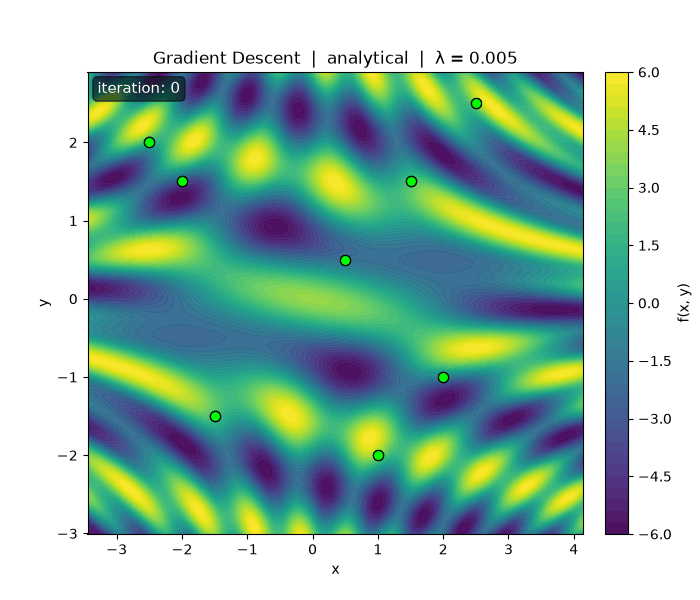
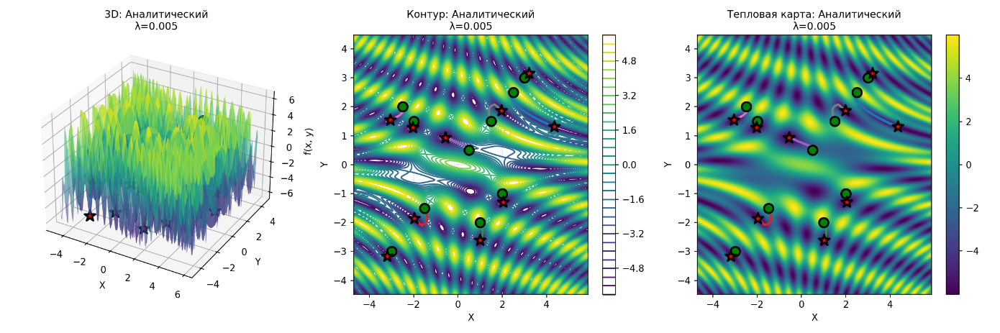
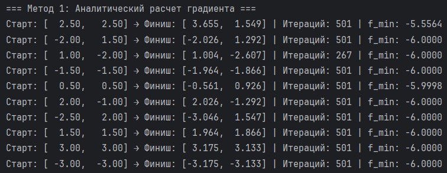
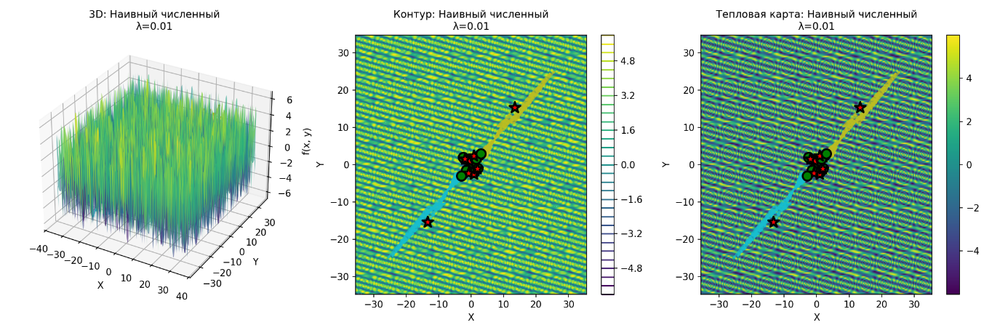
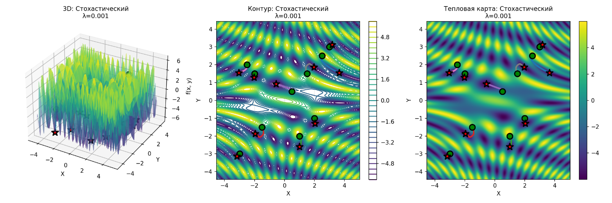
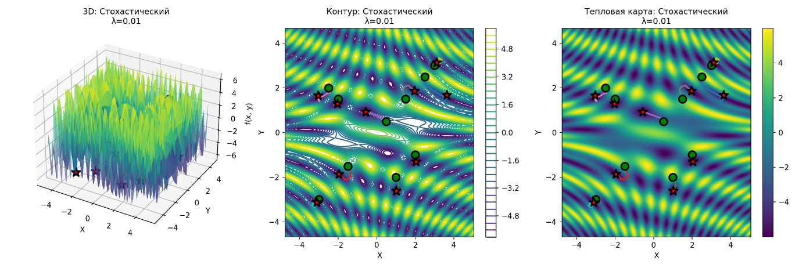

# Gradient Descent for Bivariate Function Optimization

Сравнение трёх способов расчёта градиента при численной оптимизации функции двух переменных: аналитического, наивного численного и стохастического. Проект визуализирует траектории спуска на 3D-поверхности, контурной карте и тепловой карте.

## О проекте

Градиентный спуск - базовый алгоритм оптимизации в машинном обучении. Здесь он применяется к многоэкстремальной функции

$$f(x, y) = 2\sin(3xy) + 4\cos(x + 4y)$$

и исследуется влияние:
- способа вычисления градиента;
- начальной точки;
- параметра шага $\lambda$.

На графиках: зелёный круг - старт, красная звезда - финиш, линии - траектории спуска.



Аналитический градиентный спуск, $\lambda = 0.005$: точки сходят к ближайшим локальным минимумам.

## Теория

### Градиентный спуск

Градиентный спуск ищет локальный минимум дифференцируемой функции. На каждом шаге точка смещается в сторону антиградиента - направления наискорейшего убывания функции.

Для функции $f(x, y)$ градиент - вектор частных производных:

$$\nabla f(x, y) = \begin{pmatrix} \frac{\partial f}{\partial x} \\\\ \frac{\partial f}{\partial y} \end{pmatrix}$$

Итерация градиентного спуска:

$$\begin{pmatrix} x_{i+1} \\\\ y_{i+1} \end{pmatrix} = \begin{pmatrix} x_i \\\\ y_i \end{pmatrix} - \lambda \, \nabla f(x_i, y_i)$$

где:
- $(x_i, y_i)$ - текущая точка;
- $\lambda$ - параметр шага (learning rate);
- $\nabla f(x_i, y_i)$ - градиент в текущей точке.

### Методы расчёта градиента

#### 1. Аналитический метод

Производные вычисляются заранее в символьном виде и подставляются в код.

Для целевой функции

$$f(x, y) = 2\sin(3xy) + 4\cos(x + 4y)$$

частные производные:

$$\frac{\partial f}{\partial x} = 6y\cos(3xy) - 4\sin(x + 4y)$$

$$\frac{\partial f}{\partial y} = 6x\cos(3xy) - 16\sin(x + 4y)$$

Плюсы: точность и скорость. Минус: нужен явный вид функции и возможность взять производные вручную.

#### 2. Наивный численный метод

Когда аналитические производные недоступны, используют центральные конечные разности с фиксированным шагом $\Delta$:

$$\frac{\partial f}{\partial x} \approx \frac{f(x + \Delta, y) - f(x - \Delta, y)}{2\Delta}$$

$$\frac{\partial f}{\partial y} \approx \frac{f(x, y + \Delta) - f(x, y - \Delta)}{2\Delta}$$

В проекте: $\Delta x = \Delta y = 0.001$.

Метод «наивный», потому что шаг дифференцирования выбран один раз и дальше не адаптируется.

#### 3. Стохастический численный метод

Те же центральные разности, но шаг на каждой итерации выбирается случайно:

$$\Delta_x, \Delta_y \sim U(\Delta_{\min}, \Delta_{\max})$$

$$\frac{\partial f}{\partial x} \approx \frac{f(x + \Delta_x, y) - f(x - \Delta_x, y)}{2\Delta_x}$$

$$\frac{\partial f}{\partial y} \approx \frac{f(x, y + \Delta_y) - f(x, y - \Delta_y)}{2\Delta_y}$$

В проекте: $\Delta_{\min} = \Delta / 2$, $\Delta_{\max} = 3\Delta$ при $\Delta = 0.001$.

Случайность шага помогает алгоритму устойчивее проходить «плохие» участки ландшафта (седла, плоские зоны).

### Параметры алгоритма

Параметр шага $\lambda$:
- слишком большой - расходимость или колебания около минимума;
- слишком малый - медленная сходимость.

В экспериментах: $\lambda \in \{0.001,\ 0.005,\ 0.01\}$.

Критерий остановки по норме градиента:

$$\|\nabla f(x, y)\| = \sqrt{\left(\frac{\partial f}{\partial x}\right)^2 + \left(\frac{\partial f}{\partial y}\right)^2}$$

Если $\|\nabla f\| < \varepsilon$ (здесь $\varepsilon = 10^{-6}$), алгоритм останавливается. Иначе выполняется не более $500$ итераций.

Шаг обновления координат:

$$x_{i+1} = x_i - \lambda \frac{\partial f}{\partial x}(x_i, y_i),\quad y_{i+1} = y_i - \lambda \frac{\partial f}{\partial y}(x_i, y_i)$$

## Структура проекта

```
.
├── gradient_descent.py   # основной скрипт
├── assets/               # графики результатов
├── requirements.txt
└── README.md
```

## Установка и запуск

```bash
pip install -r requirements.txt
python gradient_descent.py
```

Графики сохраняются в `assets/`. Чтобы открывать окна matplotlib, в конце файла поставьте `show_plots = True`.

## Результаты

Эксперименты: 3 метода × 3 значения $\lambda$ × 10 начальных точек. Типичные найденные минимумы: от $-5.8$ до $-6.0$.

### Аналитический метод

Стабильные плавные траектории. При $\lambda = 0.001$ сходимость медленная, но устойчивая; при $\lambda = 0.005$ - хороший баланс; при $\lambda = 0.01$ - быстрее, иногда с лёгкими колебаниями у минимума.





Пример вывода в консоль:



### Наивный численный метод

При $\Delta = 0.001$ результаты почти совпадают с аналитическими. При малых $\lambda$ траектории практически идентичны; при $\lambda = 0.01$ иногда нужно больше итераций.




### Стохастический численный метод

Траектории «дрожат» из-за случайного $\Delta$, но сходимость сохраняется. На сложных участках (седла, плато) случайность иногда помогает не застревать.






### Сравнение λ

| λ | Поведение |
|---|-----------|
| 0.001 | Самая стабильная сходимость, много итераций |
| 0.005 | Компромисс скорости и устойчивости |
| 0.01 | Быстрее, выше риск колебаний около минимума |

## Выводы

- Аналитический градиент - точнее и предсказуемее всего, но применим не всегда.
- Наивный численный метод близок к аналитическому при удачном $\Delta$.
- Стохастический метод чуть шумнее, зато устойчивее на сложных участках ландшафта.
- Градиентный спуск локален: итог сильно зависит от старта, особенно на многоэкстремальной функции.
- Для этой задачи $\lambda = 0.005$ - разумный рабочий выбор.

## Стек

- Python 3
- NumPy
- Matplotlib
